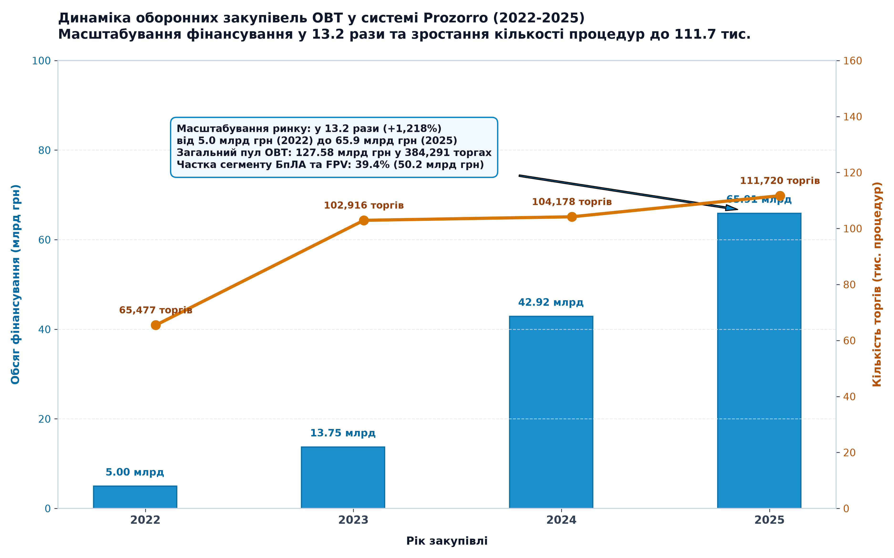
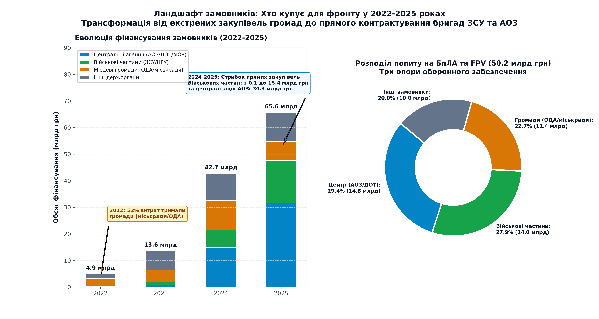
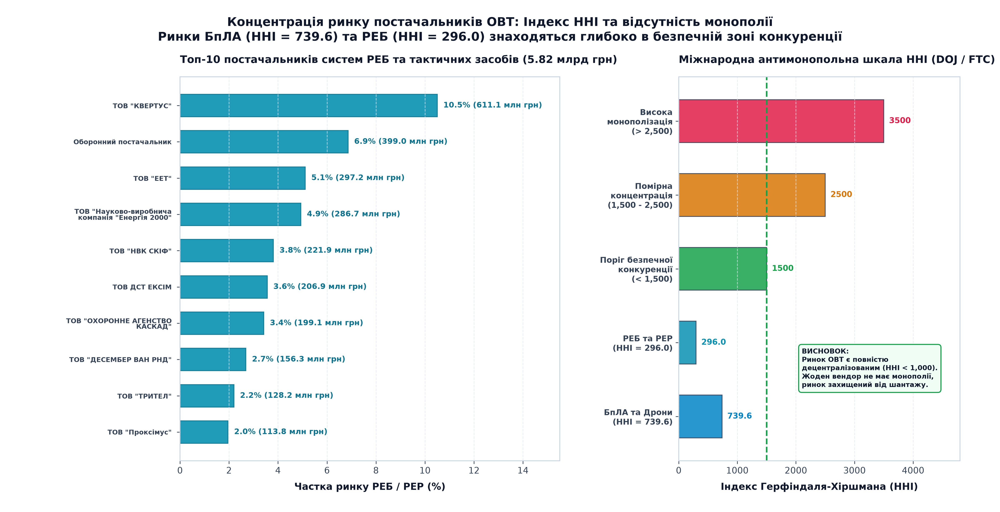
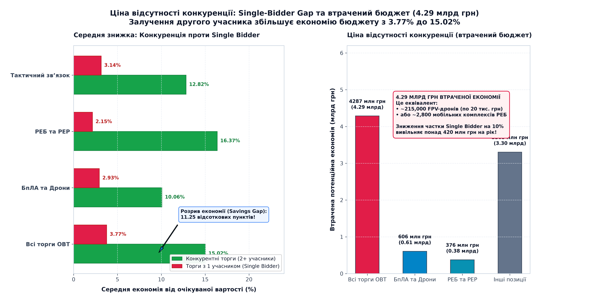

# 📊 Case 02: Defense Procurement Analytics: Market Dynamics, Pricing & HHI Concentration (Prozorro 2022-2025)

> **«Що відбувається з відкритою частиною ринку постачання БпЛА та РЕБ: де він зростає, хто формує попит, яка реальна ціна відсутності конкуренції (Single-bidder premium) та чи є монопольні ризики постачальників (індекс HHI)?»**  
> *Емпіричне дослідження 12.88 млн процедур публічних закупівель України воєнного часу (2022-2025) із фокусом на цільовий масив із 384,291 процедури ОВТ (БпЛА, FPV, РЕБ, тактичний зв'язок, електроніка та оборонний захист).*

---

## 🧭 Навігатор артефактів кейсу
- **📊 Інтерактивний Live-дашборд:** [👉 Відкрити в браузері (Live Web App)](https://alexzaremsky.github.io/miltech-data-analytics-portfolio/case_02_procurement/index.html) · [Переглянути код (index.html)](index.html) *(автономний клієнтський HTML/JS дашборд із живим симулятором економії бюджету та фільтрами)*
- **📄 Презентація (PDF, 16:9 Widescreen):** [presentation.pdf](presentation.pdf) *(безпосередній перегляд у веб-інтерфейсі GitHub)*
- **📈 Графіки високої роздільної здатності (300 DPI):**
  - [chart1_market_spend_dynamics_2022_2025.png](artifacts/chart1_market_spend_dynamics_2022_2025.png) - *Масштабування фінансування ОВТ у 13.2 рази (з 5.0 до 65.9 млрд грн) та зростання кількості торгів до 111.7 тис.*
  - [chart2_buyers_structure_state_vs_local.png](artifacts/chart2_buyers_structure_state_vs_local.png) - *Ландшафт замовників: три опори фронту (Центральні агенції АОЗ/ДОТ, Військові частини та Місцеві громади)*
  - [chart3_hhi_market_concentration_curve.png](artifacts/chart3_hhi_market_concentration_curve.png) - *Індекс концентрації HHI та топ-виробники РЕБ: відсутність монополії (HHI = 739.6 для БпЛА, 296.0 для РЕБ при нормі < 1,500)*
  - [chart4_single_bidder_savings_gap.png](artifacts/chart4_single_bidder_savings_gap.png) - *Ціна відсутності конкуренції: розрив у знижці 11.25 відсоткових пунктів (15.02% vs 3.77%) та 4.29 млрд грн втрат*
- **💻 Відтворюваний Python-пайплайн:** [scripts/README.md](scripts/README.md) *(чистий аналітичний пайплайн обробки 5.44 GB даних)*

---

## 🏛️ Канонічний звіт за десятьма блоками (Choice31 Standard)

### 🏷️ 00. BLUF (Правило перших 40 секунд)
* **Головна відповідь на ключове питання:**
  - **Фінансовий масштаб ринку:** Відкритий ринок оборонних закупівель зріс у **13.2 рази (з 5.00 млрд грн у 2022 році до 65.91 млрд грн у 2025 році)**. Сукупний обсяг укладених договорів ОВТ сягнув **127.58 млрд грн** у 384,291 процедурі. Сегмент БпЛА та FPV-дронів є безумовним локомотивом ринку, акумулювавши **50.24 млрд грн (39.38% коштів)**.
  - **Концентрація вендорів (HHI):** Ринок постачання безпілотних систем та засобів РЕБ є **високодецентралізованим та неконцентрованим**. Індекс Герфіндаля-Хіршмана становить **739.6 для БпЛА та 296.0 для РЕБ**, що знаходиться глибоко в безпечній зоні (поріг US DOJ / FTC для монополізації становить > 1,500). На ринку відсутня критична залежність від окремого монополіста: лідер ринку РЕБ (ТОВ «Квертус») займає 10.50%, а в секторі БпЛА частка найбільшого відкритого постачальника не перевищує 2.4%.
  - **Ціна відсутності конкуренції (Single-Bidder Gap):** Закупівлі з одним учасником (Single Bidder) генерують середню знижку лише **3.77% (медіана 0.75%)**, тоді як конкурентні аукціони (2+ учасники) забезпечують середню економію **15.02% (медіана 11.81%)**. Розрив у знижці становить **11.25 відсоткових пунктів**.
  - **Ціна безальтернативності для бюджету:** Через проведення торгів з 1 учасником (38.10 млрд грн витрат) держава втратила **4.29 млрд грн потенційної економії**, що еквівалентно закупівлі понад **215,000 ударних FPV-дронів** або 2,800 мобільних комплексів РЕБ.
* **Ключове рішення:** Перевести закупівлі серійних БпЛА та засобів РЕБ на обов'язкові динамічні рамкові угоди (DPS) та ліквідувати дискримінаційні бар'єри в ТЗ, забезпечивши участь мінімум 2 виробників у кожному аукціоні.

---

### 01. Context (Контекст)
* **Де відбувається задача:** Публічні оборонні закупівлі України через електронну систему **Prozorro (стандарт OCDS)** за 4 роки повномасштабної війни (**2022-2025**). Опрацьовано масив з **12,877,960 процедур (5.44 GB даних)**, з яких верифіковано профільну вибірку ОВТ з **384,291 процедури**.
* **Межі предметної області:** Досліджено 6 ключових категорій ОВТ:
  - **БпЛА, FPV-дрони та авіатехніка** (CPV 3471..., 3561...): 12,642 процедури (50.24 млрд грн).
  - **Засоби РЕБ, РЕР та тактичні станції** (CPV 3573..., 3574...): 5,170 процедур (5.82 млрд грн).
  - **Тактичний радіозв'язок та антени** (CPV 325...): 24,842 процедури (3.15 млрд грн).
  - **Комплектуючі FPV, польотні контролери, двигуни, VTX** (CPV 3023..., 316...): 256,135 процедур (23.06 млрд грн).
  - **Оборонне спорядження та засоби індивідуального захисту** (CPV 3581..., 351...): 70,980 процедур (44.99 млрд грн).
  - **Масковані оборонні закупівлі спеціального призначення**: 14,522 процедури (0.32 млрд грн).
* **Для кого цей кейс:**
  1. Директор Департаменту політики закупівель МОУ, керівництво Агенції оборонних закупівель (АОЗ) та Державного оператора тилу (ДОТ).
  2. Голови тендерних комітетів великих замовників (ОДА, ОВА, міські ради великих агломерацій, командування родів військ ЗСУ).
  3. Аналітики ринку ОВТ та волонтерських фондів.
* **Чому це критично важливо:** Під час війни ресурси держави обмежені. Кожен відсоток необґрунтованої цінової премії в контрактах з одним учасником позбавляє підрозділи сотень бортів на лінії фронту. Водночас аналіз індексу HHI дозволяє переконатися у стійкості ринку до фізичного знищення виробничих потужностей ворожими ракетами.

---

### 02. Problem (Проблема - Фільтр «Щоб що?»)
* **Канонічна формула проблеми:**
  > **Керівництво АОЗ МОУ, ДОТ та офіцери служб забезпечення бригад мають максимізувати фізичний обсяг переданого на фронт озброєння в межах бюджетних асигнувань, але змушені укладати договори в умовах безальтернативності: 41.1% відкритих торгів відбуваються з 1 учасником (Single Bidder), а 88.6% процедур взагалі проводяться за прямими звітами (limited). Через відсутність другого учасника середня знижка падає з 15.02% до 3.77%, унаслідок чого бюджет втрачає 11.25 відсоткових пунктів (4.29 млрд грн переплат), недоотримуючи понад 215,000 FPV-дронів для захисників.**
* **Справжня потреба проти симптому:**  
  - *Симптом:* «Нам не вистачає коштів, виробники виставляють високу ціну, а альтернатив немає».  
  - *Реальна потреба:* Ліквідація штучних бар'єрів входу у тендерній документації, впровадження стандартизованих ТЗ і механізму динамічних рамкових угод, які автоматично генерують аукціонний торг між 2+ вендорами.

---

### 03. Analytical Questions (Аналітичні питання)
1. **Питання 1 (Фінансовий масштаб та динаміка ринку):** Як зростав ринок відкритих закупівель ОВТ з 2022 по 2025 рік у грошовому та кількісному вираженні (млрд грн та тисячі торгів)? Яка частка припадає на БпЛА vs РЕБ vs зв'язок vs комплектуючі?
2. **Питання 2 (Ландшафт замовників - Хто формує попит):** Як розподіляється попит між центральними державними закупниками (МОУ/АОЗ/ДОТ), прямими закупівлями військових частин бригадного рівня та децентралізованими закупівлями місцевих громад (міськради, ОДА)?
3. **Питання 3 (Концентрація ринку та індекс HHI):** Наскільки ринок диверсифікований чи монополізований? Який індекс Герфіндаля-Хіршмана (HHI = sum(s_i^2)) для сегменту БпЛА та РЕБ? Яку частку контролюють топ-5 постачальників? Чи існує критична залежність від 1-2 вендорів?
4. **Питання 4 (Ціна відсутності конкуренції - Single-Bidder Gap):** Скільки бюджету втрачається через закупівлі з одним учасником (Single Bidder) проти конкурентних аукціонів (2+ учасники)? Яка середня знижка (Savings Rate) та цінова премія монопольного учасника?

---

### 04. Data & Sources (Дані та джерела)
* **Паспорт набору даних:**
  - **Джерело:** Відкритий масив даних [Prozorro Ukraine Public Procurement (2022-2025) на Kaggle (Roman Kachmar)](https://www.kaggle.com/datasets/romankachmar/prozorro-ukraine-procurement-2022-2025) *(ліцензія OCDS / TLP:WHITE)*, офіційний [Портал відкритих даних Prozorro](https://prozorro.gov.ua/).
  - **Загальний обсяг:** 12,877,960 процедур за 4 роки (5.44 GB вихідних CSV).
  - **Цільова MilTech-вибірка:** **384,291 процедура** (55.4 MB Parquet після збагачення, час читання <0.7 с).
  - **Зернистість (Grain):** **1 рядок = 1 окрема процедура закупівлі (`tender_id`)**.
* **Сліпі зони та обмеження (Limitations):**
  - **Лот замість одиниці товару:** Один рядок у системі Prozorro фіксує контракт (лот), а не окремий виріб (у межах 1 контракту може постачатися 50 важких дронів-бомберів або 5,000 FPV).
  - **Масковані оборонні закупівлі:** 14,522 процедури мають статус прихованого замовника/постачальника відповідно до законів воєнного стану (OPSEC).
  - **Закрита частина ДОЗ:** Важке стратегічне озброєння та ракети контрактуються поза Prozorro за грифом таємності.

---

### 05. Method (Метод)
* **Математична модель розрахунку концентрації та економії:**
  - **Індекс Герфіндаля-Хіршмана (HHI):**  
    `HHI = sum(s_i^2)`  
    де `s_i` - ринкова частка i-го постачальника у відсотках від загального обсягу сегменту (шкала від 0 до 10,000 пунктів). За стандартами US DOJ та FTC:
    * `HHI < 1,500`: Неконцентрований, конкурентний ринок (безпечна зона).
    * `1,500 <= HHI <= 2,500`: Помірна концентрація ринку.
    * `HHI > 2,500`: Висока концентрація (олігополія / монополія).
  - **Single-Bidder Savings Gap:**  
    `Savings_Gap = Disc_Multi - Disc_Single`  
    `Potential_Savings = Spend_Single * (Savings_Gap / 100.0)`  
    де `Disc_Multi` - середня знижка у торгах із 2+ учасниками, а `Disc_Single` - знижка при 1 учаснику.
  - **Очищення аномалій (Clipping):**  
    Значення знижок обмежено діапазоном `[0%, 95%]` для усунення помилок ручного введення операторів. Прямі звіти (`limited`) аналізувалися окремо від аукціонів.
* **Proof of Work (Верифікація методу):**  
  Повний алгоритм ETL та математичний розрахунок реалізовані у відтворюваних скриптах [scripts/01_extract_procurement_metrics.py](scripts/01_extract_procurement_metrics.py) та [scripts/02_analyze_hhi_and_pricing.py](scripts/02_analyze_hhi_and_pricing.py).

---

### 06. Findings (Ключові результати)

| Показник / Рік | 2022 | 2023 | 2024 | 2025 | Всього (2022-2025) |
| :--- | :---: | :---: | :---: | :---: | :---: |
| **Сума укладених договорів (млрд грн)** | 5.00 | 13.75 | 42.92 | 65.91 | **127.58 млрд грн** |
| **Кількість процедур ОВТ** | 65,477 | 102,916 | 104,178 | 111,720 | **384,291 торгів** |
| **Конкурентні торги (open/selective)** | 2,679 | 7,487 | 15,570 | 18,093 | **43,829 торгів** |
| **Частка Single Bidder у торгах** | 42.7% | 45.5% | 41.9% | 38.3% | **41.1%** |
| **Середня знижка при 2+ учасниках** | 15.24% | 17.07% | 14.79% | 14.44% | **15.02% (медіана 11.81%)** |
| **Середня знижка при 1 учаснику** | 3.39% | 4.14% | 3.69% | 3.72% | **3.77% (медіана 0.75%)** |
| **Розрив економії (Savings Gap)** | **+11.85 pp** | **+12.93 pp** | **+11.10 pp** | **+10.71 pp** | **+11.25 відсоткових пунктів** |
| **Сума Single-Bidder контрактів** | 0.83 млрд | 5.88 млрд | 11.09 млрд | 20.30 млрд | **38.10 млрд грн** |
| **Втрачена потенційна економія** | 98.4 млн | 760.3 млн | 1,231.0 млн | 2,174.1 млн | **4,287.0 млн грн (4.29 млрд)** |

#### 1. Фінансовий масштаб та динаміка ринку (2022-2025)

* **Факт:** Обсяг фінансування відкритого ринку ОВТ зріс у **13.2 рази (+1,218%)** - з 5.00 млрд грн у 2022 році до 65.91 млрд грн у 2025 році. Сегмент БпЛА та FPV-дронів акумулював **50.24 млрд грн (39.38% коштів)**, а компоненти дронів - **23.06 млрд грн (256 тис. процедур)**.

#### 2. Ландшафт замовників: Три опори оборонного забезпечення

* **Факт:** Відбулася кардинальна трансформація замовників. У 2022 році **52.5% перших ударних закупівель здійснили місцеві громади (ОДА та міськради)**. Проте у 2024-2025 роках завдяки субвенціям та прямому бюджетуванню спостерігається **стрибок прямих закупівель військових частин бригадного рівня у 100 разів (з 0.14 млрд у 2022 до 15.43 млрд грн у 2025)**. Центральні агенції (АОЗ/ДОТ) забезпечили 30.34 млрд грн у 2025 році. У сегменті БпЛА попит розподілений майже порівну: Центральні агенції (29.4%), Військові частини (27.9%), Громади (22.7%), Інші держоргани (20.0%).

#### 3. Концентрація ринку та індекс HHI

* **Факт:** Індекс Герфіндаля-Хіршмана становить **739.6 для БпЛА та 296.0 для РЕБ**, що перебуває глибоко в безпечній зоні міжнародних антимонопольних норм (< 1,500). На ринку відсутні монополісти. У сегменті РЕБ лідер ринку (ТОВ «Квертус») займає 10.50% (611.1 млн грн), ТОВ «ЕЕТ» - 5.11%, НВК «Енергія 2000» - 4.93%, ТОВ «НВК СКІФ» - 3.81%. Ринок захищений від системного вендор-локу.

#### 4. Ціна відсутності конкуренції (Single-Bidder Gap)

* **Факт:** У торгах з 2+ учасниками середня знижка становить **15.02%**, тоді як при 1 учаснику - лише **3.77%**. Загальний пул контрактів з одним учасником у конкурентних процедурах склав **38.10 млрд грн**. Втрачена потенційна економія бюджету досягла **4.29 млрд грн** (у т.ч. 606.0 млн грн у сегменті БпЛА та 376.3 млн грн у РЕБ).

---

### 07. Recommendation (Рекомендації)
1. **Дія 1: Стандартизація ТЗ та впровадження правила «48 годин на усунення помилок»:**
   - *Хто:* Департамент політики закупівель Міністерства оборони України.
   - *Що зробити:* Розробити та затвердити обов'язкові типові технічні специфікації (ТТХ) для серійних FPV-дронів (7, 8, 10 дюймів) та засобів окопного РЕБ. Заборонити внесення дискримінаційних вимог (вузькі локальні довідки, сертифікати застарілих зразків) та зобов'язати комісії надавати 48 годин на виправлення формальних помилок у документах. Це збільшить частку торгів із 2+ учасниками з 58.9% до 80%.
2. **Дія 2: Перехід на динамічні рамкові угоди (DPS) в АОЗ МОУ:**
   - *Хто:* Керівництво Агенції оборонних закупівель (АОЗ).
   - *Що зробити:* Перевести масові закупівлі БпЛА з поодиноких торгів на систему Dynamic Purchasing System із щомісячними мікроаукціонами між пулом попередньо кваліфікованих українських виробників. Це скоротить термін контрактування до 3-5 днів та забезпечить середню знижку на рівні 12-15%.
3. **Дія 3: Автоматичний антикорупційний червоний прапорець (Red Flag Trigger):**
   - *Хто:* Тендерні комітети ОДА, міських рад та ревізійні органи (ДААСУ).
   - *Що зробити:* Налаштувати в аналітичному модулі Prozorro автоматичний індикатор ризику: якщо замовник проводить 3 і більше процедури поспіль з одним і тим самим постачальником за нульовою знижкою (Single Bidder з дисконтом < 1.0%), процедура автоматично відправляється на моніторинг щодо штучного звуження конкуренції.

---

### 08. Decision & Value (Рішення та цінність)
* **Чиє рішення змінюється (Outcome):**  
  Керівники АОЗ, ДОТ, голови ОДА та начальники служб озброєння бригад переходять від пасивної закупівлі у єдиного відомого постачальника до системного управління конкурентним полем та використання рамкових угод.
* **Операційна цінність для оборони та бюджету:**
  - **Фінансовий ефект:** Зниження частки Single-Bidder торгів лише на 15 відсоткових пунктів (з 41.1% до 26.0%) вивільняє **понад 1.15 млрд грн щорічно**.
  - **Військовий ефект:** Вивільнені кошти дозволяють законтрактувати додатково **понад 58,000 бойових FPV-дронів на рік** без збільшення оборонного кошторису.
* **🛡️ Захисна метрика (Guardrail Metric):**
  - **Бойова надійність та якість виробів:** Зниження закупівельної ціни в жодному разі не повинно призводити до падіння якості. Відсоток успішних бойових застосувань (Mission Success Rate) бортів на ЛБЗ зобов'язаний **залишатися >= 85.0%**, а відсоток заводського браку при прийомці бригадою **не повинен перевищувати 2.0%**.

---

### 09. Limitations (Обмеження вибірки)
1. **Засекречені державні оборонні контракти:** Стратегічні ударні далекобійні БпЛА (Deep Strike) та важкі системи ППО/РЕБ контрактуються за закритими статтями оборонного бюджету і не публікуються в системі Prozorro.
2. **Анонімізовані дані воєнного стану (OPSEC):** 14,522 процедури містять приховані найменування замовників або вендорів для захисту ланцюгів постачання від ворожої розвідки.
3. **Ціна за лот проти ціни за одиницю:** Через відсутність стандартизованого поля unit_price у зведених відкритих реєстрах аналіз проводився за сумами контрактів та відсотком дисконту від очікуваної вартості.

---

### 10. Tools (Зведена таблиця інструментів проєкту)

| Інструмент / Бібліотека | Моя фактична дія у проєкті | Де перевірити |
| :--- | :--- | :--- |
| **Python 3.12 (Pandas / PyArrow)** | Збагачення 384,291 тендеру, мердж із реєстрами замовників та постачальників, функціональна класифікація замовників | [scripts/01_extract_procurement_metrics.py](scripts/01_extract_procurement_metrics.py) |
| **NumPy & SciPy** | Векторизований розрахунок індексу Герфіндаля-Хіршмана (HHI), часток ринку CR4/CR5/CR10 та Single-Bidder розриву | [scripts/02_analyze_hhi_and_pricing.py](scripts/02_analyze_hhi_and_pricing.py) |
| **Matplotlib & Seaborn** | Побудова 4 інфографік публікаційного рівня 300 DPI у строгій світлій темі з подвійним маркуванням показників | [scripts/03_generate_procurement_charts.py](scripts/03_generate_procurement_charts.py) |
| **HTML5 / JavaScript / Chart.js** | Створення автономного клієнтського веб-дашборду з динамічними фільтрами та сценарним симулятором економії | [index.html](index.html) |
| **Презентація (PDF)** | Підготовка аналітичної презентації (16:9 Widescreen) на 11 слайдів за шаблоном Choice31 | [presentation.pdf](presentation.pdf) |
